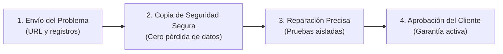

# ⚡ Light | Desarrollador Experto en WordPress y WooCommerce

**Resolución de Emergencias, Corrección de Errores y Optimización de Rendimiento de Primer Nivel para WordPress y WooCommerce**

[🌐 Ver Landing Page en Vivo](index.html) • [📩 Contactar Directamente](mailto:lighttzx@proton.me) • [💰 Ver Precios](#paquetes-de-precios) • [🧰 Herramientas de Diagnóstico Gratuitas](wp-tools/)

---

## 📌 Sobre Mí

Hola, soy **Light** — desarrollador full-stack de WordPress y WooCommerce especializado en solucionar emergencias críticas, la Pantalla Blanca de la Muerte (WSOD), fallos en el proceso de pago (checkout), infecciones por malware y tiempos de carga lentos.

Con más de 500+ restauraciones exitosas de sitios web, ayudo a propietarios de tiendas de comercio electrónico, agencias y emprendedores a eliminar el tiempo de inactividad y recuperar ingresos perdidos rápidamente con una **garantía de devolución del 100% de su dinero**.

---

## 🛠️ Servicios Ofrecidos

| Servicio | Descripción | Entrega Típica |
| :--- | :--- | :--- |
| **🚨 Reparación de Error Crítico en WordPress (WSOD)** | Solución de "Ha habido un error crítico en esta web", errores PHP Fatal, agotamiento de memoria y Errores Internos del Servidor 500. | < 4 Horas |
| **🛒 Corrección de Errores y Checkout en WooCommerce** | Corrección de ruedas de carga infinitas en el checkout, pasarelas rotas de Stripe/PayPal, actualizaciones AJAX del carrito y cálculos de impuestos/envíos. | < 6 Horas |
| **⚡ Optimización de Velocidad y Core Web Vitals** | Reducción de TTFB, aplazamiento de scripts, compresión WebP y limpieza de sobrecarga en la base de datos. Objetivo de 90+ en Google PageSpeed. | 24 - 48 Horas |
| **🛡️ Eliminación de Malware y Fortalecimiento de Seguridad** | Limpieza de scripts backdoor, inyecciones de spam, eliminación de advertencias de Sitio Engañoso en Google y configuración de firewalls. | 24 - 48 Horas |
| **🎨 Personalización de Temas Elementor y Divi** | Correcciones de diseño CSS, ajustes responsivos para móviles y tablets, modificaciones en temas hijo (child themes) y arreglos en cabeceras/pies de página. | 24 Horas |
| **🔄 Conflictos de Plugins y Actualizaciones Fallidas** | Reversión segura de versiones mediante FTP/SSH, parches de compatibilidad para PHP 8.1/8.2/8.3 y sincronización de REST API. | < 6 Horas |

---

## 💰 Paquetes de Precios

Inspirados en las mejores ofertas de Fiverr Pro:

### 🟢 Paquete Básico — $15
- 1 Error específico, corrección de CSS o ajuste menor de estilo
- Ajuste de configuración de plugin o tema
- Copia de seguridad completa previa al trabajo
- 1 Revisión
- *Entrega: 24 Horas*

### 🟢 Paquete Estándar (Más Popular) — $30
- Error Crítico de WordPress (WSOD) o fallo en el checkout de WooCommerce
- Hasta 3 problemas relacionados o registros de error resueltos
- Puesta a punto rápida de base de datos y caché
- Copia de seguridad completa previa al trabajo
- 3 Revisiones + 7 Días de garantía posterior al arreglo
- *Entrega: 24 Horas*

### 🟢 Paquete Premium — $55
- Erradicación Completa de Malware + Eliminación de Lista Negra de Google **O**
- Optimización Completa de PageSpeed con 90+ en Core Web Vitals
- Correcciones ilimitadas relacionadas en 1 dominio
- Fortalecimiento de seguridad e implementación de firewall
- Revisiones ilimitadas + 14 Días de soporte extendido prioritario
- *Entrega: 48 Horas*

---

## 🧰 Herramientas Gratuitas de WordPress Incluidas

Este repositorio incluye scripts PHP independientes para diagnósticos de emergencia en [`wp-tools/`](wp-tools/):

1. **`wp-diagnostic.php`**: Analizador en un clic del entorno del servidor, límites de memoria, plugins activos y registros de errores.
2. **`wp-fix-common-errors.php`**: Asistente automatizado seguro para aumentar los límites de memoria de PHP, restablecer `.htaccess` y desactivar plugins defectuosos sin necesidad de acceso a la base de datos.
3. **`wp-security-scan.php`**: Escáner de sumas de verificación (checksums) que verifica los archivos del núcleo de WordPress contra versiones oficiales y detecta backdoors sospechosos con eval/base64.

---

## 🔄 Proceso de 4 Pasos Sin Riesgo

1. **Envío del Problema**: Compartes el enlace de tu sitio web, los síntomas del error o un acceso temporal de administrador.
2. **Copia de Seguridad Segura**: Se realiza una instantánea completa de archivos y base de datos antes de tocar una sola línea de código.
3. **Reparación Precisa**: El fallo se aísla mediante los registros de errores de PHP, se repara y se prueba exhaustivamente en diferentes navegadores y pantallas móviles.
4. **Aprobación y Garantía**: Verificas la solución. Respaldado por una política de reembolso del 100% de **Si no se soluciona, no pagas** (No Fix, No Fee).

---

## 📬 Cómo Contactar y Contratar

¿Listo para reparar tu sitio web? Contáctame directamente a través de:

- **Correo electrónico**: [lighttzx@proton.me](mailto:lighttzx@proton.me)
- **Fiverr**: Consultas directas y pedidos personalizados disponibles
- **GitHub**: [github.com/lighttzx](https://github.com/lighttzx)

> [!TIP]
> Incluye la **URL de tu sitio web**, una **descripción o captura del error** y el nivel de urgencia en tu correo electrónico para un diagnóstico y presupuesto inmediato.

---

## 💻 Stack Tecnológico y Herramientas

- **Núcleo**: PHP 7.4 / 8.0 / 8.1 / 8.2 / 8.3, MySQL, MariaDB, Apache, Nginx, OpenLiteSpeed
- **Plataformas**: WordPress Core, WooCommerce, WordPress REST API, Multisite
- **Constructores Visuales**: Elementor, Elementor Pro, Divi, Gutenberg, Beaver Builder, WPBakery
- **Optimización**: WP Rocket, LiteSpeed Cache, Perfmatters, Redis, Cloudflare CDN
- **Seguridad**: Wordfence, Sucuri, iThemes Security, SSH/SFTP, WP-CLI

---

## 📄 Licencia

Este repositorio se mantiene con fines de demostración de portafolio y captación de clientes. Contenido copyright &copy; Light.
